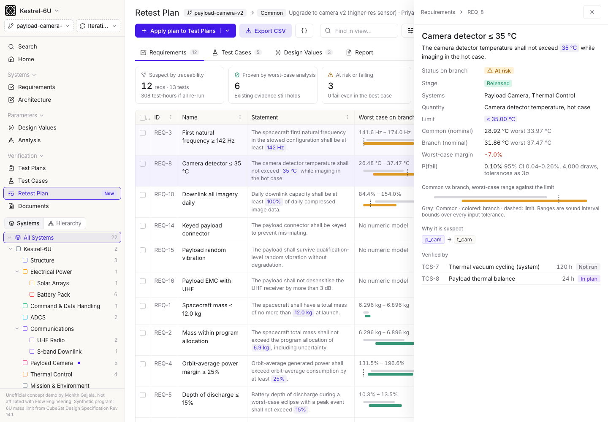

# Retest Plan: margin-aware impact analysis and the cheapest re-verification for a Flow branch

**Live demo:** https://mohith26.github.io/flow-retest-plan/

When a design value changes on a branch, Flow marks every requirement that traces to it Suspect, and every test case that verifies those requirements goes Suspect too. That is the right default for traceability, but it turns a +180 g camera change into "re-run 13 tests, 308 test-hours". **Retest Plan** adds two things on top of the graph: (1) worst-case interval analysis over every design value's tolerance, which *proves* that some suspect requirements are still met no matter where the tolerances land, and (2) an exact minimum-cost set cover that picks the cheapest combination of test cases that still re-verifies everything that is genuinely at risk. It sits under Verification next to Test Plans and Test Cases, works per branch, and can be applied to create pending test runs.



## Results (`data/results.json`, demo program Kestrel-6U)

| Branch | Change | Suspect by traceability | Proven by worst-case analysis | At risk / re-verify | Retest plan | Test-hours saved |
|---|---|---|---|---|---|---|
| payload-camera-v2 | camera +180 g, +2.1 W, larger images | 12 reqs, 13 tests, 308 h | 6 | 3 at risk + 3 re-verify | **5 tests, 68 h** | **78%** |
| battery-cell-swap | 3.5 Ah cells, +1.5 g/cell, lower resistance | 10 reqs, 9 tests, 266 h | 7 (+1 value unchanged) | 2 re-verify | 2 tests, 22 h | 92% |
| thermal-strap-redesign | camera strap R 1.4 → 1.12 K/W, +30 g | 8 reqs, 7 tests, 201 h | 5 (+2 unchanged) | 1 re-verify | 1 test, 3 h | 99% |

On the camera branch the at-risk items are exactly the ones an engineer would worry about: first natural frequency (worst case 141.6 Hz vs ≥ 142 Hz), camera detector temperature (worst case 37.5 °C vs ≤ 35 °C) and daily downlink (worst case 84% of image data vs ≥ 100%). Mass, power margin, depth of discharge, battery temperatures and slew time are proven with margin, so their existing evidence stands. Editing any value or tolerance on the Design Values tab re-runs the whole analysis in the browser (e.g. a 1.9 kg camera pushes the program mass allocation into "at risk" and adds the 6-hour mass-properties test: 6 tests, 74 h).

## How it works (`core/retest.js`)

1. **Model.** Design values with nominal and tolerance (absolute or %), derived values as formulas (`n_cells * cap_ah * v_cell`, `f_ref * sqrt(6.0 / m_total)`, `t_hot + r_cam * p_cam`, ...) parsed by a small recursive-descent parser, requirements as `quantity <= limit` / `>= limit`, plus qualitative requirements traced to systems, and test cases with hours and the requirements they verify.
2. **Worst-case ranges.** Interval arithmetic over the formula DAG in topological order. Interval arithmetic is *sound*: every combination of in-tolerance inputs lands inside the computed range (property-tested on 400 random expressions and on every demo branch). It can be conservative when a value appears twice in a formula, which only ever pushes items toward "at risk", never toward "proven".
3. **Classification.** For each requirement downstream of a changed value: Proven (worst case meets the limit), Fails (best case misses it), At risk (range straddles it). Numeric requirements on a changed system whose value does not depend on the change keep their evidence ("value unchanged"); qualitative ones on a changed system need re-verification.
4. **Exact minimum retest set.** Weighted set cover over the at-risk and re-verify requirements, costs = test hours, solved by branch and bound (most-constrained element first, greedy upper bound, disjoint-packing lower bound). Checked against brute force on 300 random instances.
5. **P(fail)** for at-risk items: Monte Carlo with every tolerance read as a truncated 3σ normal and a Wilson 95% interval; it orders the risk, the plan itself uses the worst case.

## The app

Rebuilt in Flow's shell: project switcher, branch and Iterations selectors, the sidebar sections (Systems, Parameters, Verification) and the Systems/Hierarchy tree, page title and button bar (primary split button, Find in view, Display, Sort by, Filters, Views), tables with ID / Name / Statement columns, value chips and Released stage chips, and an item detail panel.

* **Requirements** tab: every suspect requirement with its worst-case range vs. the limit (Common in gray, branch in color), status, P(fail) and the tests chosen to re-verify it. Click a row for the detail panel: fields, margins, the dependency path from the changed value, and linked tests.
* **Test Cases** tab: re-run / skip decision for every suspect test, with the reason (proven vs. covered by a cheaper test).
* **Design Values** tab: what-if editing of nominal and tolerance; persisted per branch in localStorage.
* **Report** tab: merge-readiness summary.
* **Actions:** Apply plan (creates pending runs), Export CSV/JSON, branch switcher, sort, filter, find.
* **Keyboard:** `/` find, `j`/`k` move, `Enter` open, `Esc` close, `e` export. Deep links: `#/b/<branch>/<tab>?req=REQ-8`.

## Run it

```
node --test test/*.test.mjs   # 13 tests (CI workflow in ci/test.yml; move to .github/workflows/ to enable)
node scripts/model.mjs        # rebuild data/model.json
node scripts/results.mjs      # rebuild data/results.json
python3 -m http.server        # open http://localhost:8000
```

## Honest limitations

* **Synthetic program.** Kestrel-6U is made up. The 6U mass limit (12.0 kg) is from the CubeSat Design Specification Rev 14.1; component values are typical public datasheet figures; tolerances, allocations and test hours are assumptions.
* **Skipping a test needs an analysis-based verification method.** "Proven by analysis" is sound for the model, but a program may still require test evidence for some requirements regardless of margin; that policy would be a per-requirement flag.
* **Any-one-test coverage.** A requirement counts as re-verified if one linked test is re-run. Requirements that need several tests together would be a small change (cover with multiplicity).
* **Model fidelity bounds the proof.** The guarantee is about the formulas and tolerances in the graph; an unmodelled coupling is invisible to it, which is why qualitative requirements on changed systems always stay in the plan.
* Interval arithmetic can be loose for formulas that reuse a variable; affine arithmetic or monotonicity-aware bounds would tighten it.

## Prior art and novelty

* Flow already has Suspect propagation with configurable triggers (changelog Jan 2026), formulas and Design Values linked to Excel cells (release notes Sep 2026), verification rollups, a Project watcher that flags drift from a design value and requirements with no verification, and an impact-analysis agent plus a Mass, Cost and Power Budget agent on the homepage (point-value threshold checks). Checked: docs.flowengineering.com release notes Jul 17 to Nov 6 2026, the Productlane changelog, product pages for Systems Graph, Requirements Management and Branching.
* Not found in any of them: tolerance-aware worst-case proofs that clear suspect items, or an optimal (minimum-cost) retest selection. Classic requirements tools (DOORS, Jama, Polarion) are best known for suspect-link propagation; I did not check every MBSE budget tool.
* The building blocks are standard (interval arithmetic, weighted set cover); the contribution is wiring them into branch review so suspect propagation ends in a provably sufficient, minimum-cost retest list.

Unofficial concept demo by Mohith Gajjela. Not affiliated with Flow Engineering. Synthetic data.
